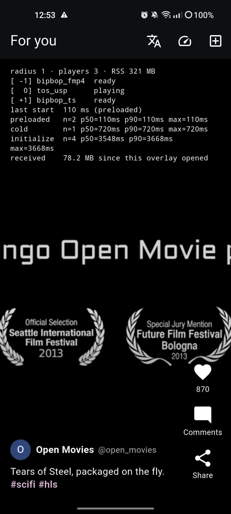
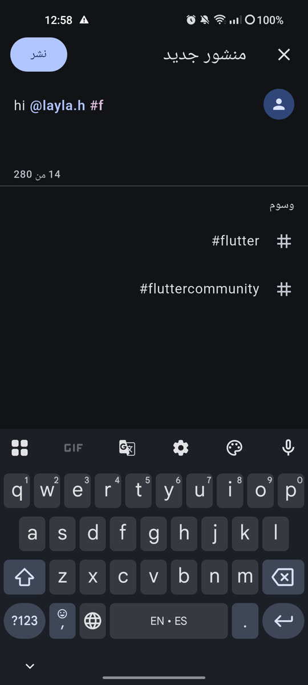

# Short Video Feed

A Flutter demo of a vertical short-video feed, built to work through the parts of a social video app that are easy to get wrong:

- **A video controller pool** that preloads the previous, current and next videos, disposes the rest, shows a first-frame poster until frames are moving, and plays only what is on screen. It plays public HLS test streams.
- **A paginated feed** with infinite scroll and pull-to-refresh, built with Riverpod (`AsyncNotifier` and `riverpod_generator`).
- **A post composer** with `@mention` and `#hashtag` suggestions, in English and Arabic, with full RTL layout and correct caret behaviour in mixed Arabic/Latin text.
- **Tests and CI**: unit, widget, Riverpod, mocktail and golden tests, run by GitHub Actions along with `flutter analyze` and an Android debug build.

The numbers below were measured on a real phone in profile mode.

| Feed (English) | Feed (Arabic, RTL) | Composer (Arabic) |
|---|---|---|
|  |  |  |

## Contents

- [How preloading works](#how-preloading-works)
- [Measurements](#measurements)
- [Trade-offs](#trade-offs)
- [RTL and the composer](#rtl-and-the-composer)
- [Tests](#tests)
- [CI](#ci)
- [Running it](#running-it)
- [Project layout](#project-layout)
- [Limitations](#limitations)
- [Media credits](#media-credits)

## How preloading works

All of it is in [`VideoControllerPool`](lib/feed/playback/video_controller_pool.dart). The feed page tells the pool which page is active; the pool decides which players exist and which one plays.

```
                 feed index:   3        4        5        6        7
 preload radius 1:                    [prev]  [ACTIVE]  [next]
 player state:   disposed    ready,    playing   ready,    disposed
                             paused,             paused,
                             at 0:00             first frame decoded
 init order:                   3rd       1st       2nd
```

The rules:

1. **Window.** Keep a player for the active post and `preloadRadius` posts on each side (default 1, so at most 3 players). Anything outside the window is disposed at once, even if it is still initialising.
2. **Priority.** The active post initialises first, then the next one, then the previous one, then the next two out, and so on. Initialisation is **sequential**: one player at a time, so the video the user is looking at never competes with its neighbours for bandwidth or a hardware decoder.
3. **Only the active post plays**, and only while playback is allowed: the feed route is on top (`RouteAware`) and the app is `resumed` (`AppLifecycleListener`). Opening the composer or locking the phone pauses without throwing away the preloaded window. Tap-to-pause is reset whenever the active post changes.
4. **A post that stops being active is paused and rewound to 0:00**, so coming back to it shows the same frame as its poster.
5. **Players are keyed by post id, not list index.** Appending a page or refreshing the feed can't hand a player to the wrong post.
6. **First-frame posters.** Each post has a poster that is the stream's real first frame (extracted with `ffmpeg` and bundled). It sits on top of the video until the player reports `isPlaying` with `position > 0`, then fades out over 120 ms. Because the poster and the first decoded frame are the same picture, cropped the same way (`BoxFit.cover`), the swap is invisible. In a production app the poster would be a CDN thumbnail from the API.
7. **Races.** `VideoPlayerController.initialize()` never completes if the controller is disposed mid-flight. Each slot therefore has its own `settled` future that also completes on disposal, and each reconcile pass carries a generation number, so a stale pass stops at its next `await`. A fast swipe from post 0 to post 6 disposes post 0's half-initialised player and never plays it; there is a test for exactly that.
8. **Failures** (init error or a 20 s timeout) mark that slot as failed with a retry button. They don't block the neighbours.

The debug overlay (the speedometer icon in the app bar) shows the pool live: which posts hold players, their state, the last start-up time and process RSS.

## Measurements

**Setup.** OnePlus 8 (IN2011: Snapdragon 865, 8 GB RAM, Android 13), **profile** build, home Wi-Fi in India, streaming public test streams from their own servers. [`integration_test/feed_benchmark_test.dart`](integration_test/feed_benchmark_test.dart) drives the real app: it waits for the first video, then swipes 20 times with 4 seconds on each post. [`tool/benchmark.sh`](tool/benchmark.sh) runs it once per preload radius and samples memory with `dumpsys meminfo` every 2 seconds. Two complete runs, so 39 start-ups per radius (one swipe per run didn't produce a usable sample; see below).

The runs used an 8-stream catalogue. One of them, Shaka Player's *Angel One* demo clip, turned out to be an excerpt from a TV episode, so I removed it from the app afterwards. The app now ships the other 7 streams. Rerun `tool/benchmark.sh` to measure the current catalogue.

- **Start-up** is the time from the page change to the first moving frame: the player reports `isPlaying` and `position > 0`.
- **Ready when shown** means the player had finished `initialize()` before its page became active.
- **Peak PSS** is the highest sample for the app plus the `media.codec` (hardware video) and `media.swcodec` (AAC audio) processes. Android decodes in those processes, not in the app.
- **Received** is the bytes the app received during the 20 swipes, from Android's `TrafficStats`. It was added for the second run only, so it is a single run.

| Preload radius | Players (max) | Ready when shown | Start-up p50 | p90 | Peak PSS, app + codecs | Received in 20 swipes |
|---|---|---|---|---|---|---|
| 0 (no preloading) | 1 | 0 of 39 | **1138 ms** | 3086 ms | 277–285 MB | 160 MB |
| **1 (default)** | 3 | 36 of 39 | **117 ms** | 225 ms | 309–328 MB | 233 MB |
| 2 | 5 | 36 of 39 | **116 ms** | 146 ms | 346–359 MB | 368 MB |

<details>
<summary>All columns, and how to regenerate this table</summary>

Produced by `dart run tool/summarize_benchmarks.dart docs/benchmarks/run2 docs/benchmarks/run4` from the raw files in [`docs/benchmarks/`](docs/benchmarks). Ranges are min–max across the two runs.

| Radius | Players (max) | Swipes | Ready when shown | Start-up p50 | p90 | max | Peak PSS: app | of which graphics | codec processes | app + codecs | Received |
|---|---|---|---|---|---|---|---|---|---|---|---|
| 0 | 1 | 39 | 0 of 39 | 1138 ms | 3086 ms | 4311 ms | 248–254 MB | 90–92 MB | 35–37 MB | 277–285 MB | 160 MB |
| 1 | 3 | 39 | 36 of 39 | 117 ms | 225 ms | 3037 ms | 278–298 MB | 109–111 MB | 37–38 MB | 309–328 MB | 233 MB |
| 2 | 5 | 39 | 36 of 39 | 116 ms | 146 ms | 1228 ms | 313–326 MB | 122 MB | 39–40 MB | 346–359 MB | 368 MB |

`initialize()` p50 per run: radius 0: 925 and 1080 ms; radius 1: 1153 and 1371 ms; radius 2: 2544 and 1956 ms. No initialisation failures. The first video after the feed loads started in 686–839 ms in every run; it is not in the table.

</details>

What the numbers say:

- **Preloading one post each way cuts the median start-up from about 1.1 s to about 0.12 s, and p90 from about 3.1 s to about 0.2 s.** About 117 ms is close to the floor of this measurement, because video_player polls the position every 100 ms.
- **The misses at radius 1** (3 of 39) were the two slowest streams to initialise, Apple's 1080p fMP4 *bipbop* and Unified Streaming's *Tears of Steel*: 4 seconds on the previous post wasn't long enough to get them ready. *Tears of Steel* took 3–4 s to start even as the only player.
- **Radius 2 improves the tail (p90 146 ms against 225 ms) but slows every initialisation.** Five players buffering at once share the same bandwidth, so the median `initialize()` rose from about 1.2–1.4 s to 2–2.5 s. In the first run that left 3 of 19 posts not ready.
- **Memory.** Each extra pair of players added about 20–50 MB of peak PSS (app plus codec processes, depending on which streams were in the window). Roughly 10–20 MB of that is the app's `Graphics` row, the decoded-frame buffers. The codec processes themselves grew by only 1–3 MB.
- **Data.** Preloading is mainly paid for in bandwidth: +46% at radius 1 and +130% at radius 2 for the same 20 posts. Even at radius 0 the app pulled 160 MB to show 80 seconds of video, about 8 MB per post, because ExoPlayer's default buffering loads well ahead of the 4 seconds each post was watched.

Not measured, so not claimed: iOS numbers, a low-end Android phone, mobile data, and results across networks.

**Run hygiene.** One extra run was discarded because a flash-SMS popup covered the app part-way through. The app correctly treated that as `inactive` and paused, so the remaining swipes recorded nothing. A start-up still pending when the next swipe happens isn't counted, which drops the one or two slowest cold starts and slightly flatters radius 0.

## Trade-offs

**Why radius 1 is the default.** It gets almost all of the start-up win with three players. Radius 2 adds about 60% more data (368 MB against 233 MB), two more hardware decoders and another 20–50 MB of memory, for a better p90 that users would rarely notice. On a low-end phone with fewer hardware decoder instances, or on mobile data, radius 1 is also the safer choice.

**Sequential rather than parallel initialisation.** The active post gets the network and a decoder first, and a slow neighbour can't delay what is on screen. The cost: when a stream is slow to initialise, the posts after it wait. Parallel initialisation would reduce those misses at the price of slower first frames for the active post. I didn't measure parallel.

**The data cost is mostly a buffering problem, and Dart can't fix it.** A paused, preloaded ExoPlayer keeps filling its buffer to the default target (up to 50 seconds of media), even though the user may never reach that post. The right fix is to cap the buffer for preloaded players to the first couple of seconds, or to use Media3's `PreloadManager` and a shared disk cache. video_player exposes none of that; its only buffer setting is `backBufferDurationMs`. That would mean native code or a forked plugin, which is the main thing I'd try next.

**Rewind when a post stops being active.** It is simple and keeps the poster honest, because the poster is the first frame. It loses the playback position, which matches how short-video feeds usually behave.

**Window follows `onPageChanged`**, which fires when a drag passes the halfway point, not when it settles. Preloading starts sooner, but a fast fling through several posts creates and disposes players along the way. A cheaper option would be to promote only the active post during a fling and preload neighbours once scrolling settles. Not done.

**`inactive` pauses playback.** Lock screen over the app, notification shade, system dialogs and a flash SMS all pause the video. This is the conservative choice for a feed with sound. The alternative is to keep playing while a translucent system UI is up.

**Bundled posters.** Using each stream's real first frame makes the handoff seamless, but a real backend has to generate that frame and serve it with the same crop. A mid-video thumbnail would flash when the first frame replaced it.

## RTL and the composer

The app ships English and Arabic (`lib/l10n/*.arb`, generated with `gen-l10n`), including Arabic's six plural forms (`=0`, `=1`, `=2`, `few`, `many`, `other`) for counts such as "3 إشارات" (3 mentions) and "11 وسمًا" (11 hashtags). Switch language with the translate icon in the app bar.

**Layout** uses only directional values: `EdgeInsetsDirectional`, `AlignmentDirectional` and `PositionedDirectional`. In Arabic the caption block moves right and the action rail moves left with no per-locale code. The video itself is not mirrored. [Golden tests](test/golden/goldens) lock both layouts.

**Text direction follows the content, not the UI.** Captions and the composer field use the direction of the first strong character, skipping anything inside bidi isolates (Unicode UAX #9, rules P2 and P3; the same thing HTML's `dir="auto"` does). An Arabic caption reads right-to-left inside the English UI. Typing Arabic into the English composer flips the field to RTL, so the caret sits at the visual end of the line instead of on the wrong side.

**Mentions are bidi-isolated.** In an RTL paragraph, `مرحبا @raghav` renders as `raghav@`: the `@` is a neutral character between an Arabic word and a Latin one, so it takes the paragraph's RTL direction and lands on the wrong side. Picking a suggestion inserts the token as FSI + `@raghav` + PDI (U+2068, U+2069), which keeps the `@` attached on the left. FSI takes its direction from the token's own first letter, so the same wrapper also works for `#flutter` and `#فلاتر`. [`entities_test.dart`](test/composer/entities_test.dart) proves both cases by laying the text out with `TextPainter` and comparing the x-positions of the `@` and the first letter. Read-only captions add the isolates at render time, so stored text stays plain.

**Inserted tokens are atomic** ([`EntityEditingController`](lib/composer/entity_editing_controller.dart)):

- The caret never stops inside one. Moving forward into a token jumps to its end, moving backward jumps to its start. Without this, the two invisible isolate marks would each cost an extra arrow-key press.
- A deletion that cuts into a token removes the whole token. A single backspace after `@layla.h` deletes the mention, not just the closing isolate mark.
- Caret snapping is skipped while the IME is composing. Whole-token deletion still applies, because some keyboards put the word before the caret into a composing region when you backspace into it.
- Mentions you type by hand, without picking a suggestion, stay ordinary text.

Checked on the OnePlus 8 with Gboard, in the Arabic UI: after picking `@layla.h`, the first tap on Gboard's backspace removes the trailing space and the second removes the whole mention (the counter goes 12 → 11 → 3).

Hashtag parsing accepts any script, including Arabic letters with harakat. A tag needs at least one letter, and `#` glued to a preceding letter (such as `و#برمجة`) is not a tag, matching other networks. Email addresses are not mentions.

## Tests

79 tests. Run them with `flutter test`.

| File | Kind | Covers |
|---|---|---|
| [`video_controller_pool_test.dart`](test/feed/video_controller_pool_test.dart) | unit, **mocktail** | Priority order; sequential init; only the active post plays; eviction outside the window; a fast swipe disposing a half-initialised player that must never play; pause-and-rewind; id keying across page appends; playback gating; failure and retry; start-up metrics (17) |
| [`feed_controller_test.dart`](test/feed/feed_controller_test.dart) | **Riverpod**, mocktail | First page; first-page error; `loadMore` append and de-dupe; no double fetch while loading; load-more error keeps the feed; end of feed; refresh; a page arriving after a refresh is dropped; failed refresh keeps posts (9) |
| [`demo_feed_repository_test.dart`](test/feed/demo_feed_repository_test.dart) | unit | Cursor paging, unique ids, refresh epochs, bad cursors (4) |
| [`entities_test.dart`](test/composer/entities_test.dart) | unit | Mention and hashtag parsing (Arabic, emails, `#1`), the typing query at the caret, first-strong direction, **bidi `@` placement measured with `TextPainter`**, composing-range spans (20) |
| [`entity_editing_controller_test.dart`](test/composer/entity_editing_controller_test.dart) | unit | Suggestion insertion and caret placement in LTR and RTL, atomic delete (also while composing), caret snapping forward, backward and nearest (11) |
| [`composer_page_test.dart`](test/widget/composer_page_test.dart) | widget | Suggestions, insertion, field direction in both UIs, mirrored layout, Post result, the counter ignoring isolate marks (6) |
| [`feed_page_test.dart`](test/widget/feed_page_test.dart) | widget | Play and preload on load, the swipe window, infinite scroll to the end, pause under the composer route, pause in the background, pull-to-refresh, mirrored overlay (8) |
| [`rtl_golden_test.dart`](test/golden/rtl_golden_test.dart) | **golden** | Feed post and composer, English and Arabic (4) |

Widget and golden tests replace `VideoPlayerController` through a Riverpod provider override with a fake that never touches the platform ([`test/helpers/fakes.dart`](test/helpers/fakes.dart)). The pool tests use mocktail mocks so they can verify the exact `play`, `pause`, `seekTo` and `dispose` calls.

The golden tests use Flutter's test font, which draws every glyph as a box, so they lock the layout (what moves in RTL and what doesn't) rather than the type. Glyph order inside a line is covered by the `TextPainter` test above.

## CI

[`.github/workflows/ci.yml`](.github/workflows/ci.yml) runs on every push to `main` and on pull requests:

| Job | Runner | What it checks |
|---|---|---|
| Analyze and test | ubuntu | Generated code (`build_runner`, `gen-l10n`) matches its sources, `dart format`, `flutter analyze`, all non-golden tests |
| Golden tests | macos | `flutter test --tags golden`; diff images are uploaded if it fails |
| Android debug build | ubuntu | `flutter build apk --debug` |
| Secret scan | ubuntu | `gitleaks` over the full git history |

Golden tests run on macOS because that is where their baselines were generated; text anti-aliasing differs on Linux.

`tool/check.sh` runs the same checks locally.

## Running it

Requires Flutter 3.47.5 (stable).

```bash
flutter pub get
```

```bash
flutter run
```

Build-time switches, passed with `--dart-define`:

| Name | Default | Effect |
|---|---|---|
| `PRELOAD_RADIUS` | `1` | Players kept on each side of the active post. `0` turns preloading off. |
| `SHOW_PLAYBACK_HUD` | `false` | Opens the playback stats overlay on launch. |

There are no API keys. `.env*`, `dart_defines*.json`, signing files and Firebase/Sentry config files are in `.gitignore` from the first commit, and CI runs `gitleaks`.

To reproduce the measurements on an Android phone, run:

```bash
tool/benchmark.sh <device-id> 0 1 2
```

To regenerate code after changing a provider or an `.arb` file, run:

```bash
dart run build_runner build --delete-conflicting-outputs && flutter gen-l10n
```

## Project layout

```
lib/
  app/                 MaterialApp, locale toggle, route observer, build switches
  feed/
    domain/            VideoPost
    data/              FeedRepository interface, demo backend, stream catalogue
    application/       FeedController (AsyncNotifier) and FeedState
    playback/          VideoControllerPool, PlaybackMetrics, providers
    ui/                FeedPage, VideoPostView, PostOverlay, PlaybackHud
  composer/            entity parsing, bidi helpers, EntityEditingController, ComposerPage
  l10n/                app_en.arb, app_ar.arb (+ generated/)
test/                  unit, widget, Riverpod and golden tests
integration_test/      profile-mode benchmark (feed_benchmark_test.dart)
tool/                  benchmark.sh, check.sh
```

## Limitations

- **One device, one network.** The numbers come from one Android phone on home Wi-Fi in India, streaming from servers abroad. They show the relative effect of preloading, not absolute numbers you would see elsewhere.
- **No iOS measurements.** Profile mode needs a physical iPhone. The app was built and run on an iOS 27 simulator in debug mode (feed, preloading, Arabic layout and the composer's layout checked), but none of the numbers above are from iOS.
- **Start-up resolution is about 100 ms.** video_player polls the playback position every 100 ms, and "first moving frame" is detected from that, so values under about 120 ms mostly measure the polling interval.
- **Typing through the iOS simulator's injected keyboard closed the composer** in one manual check: the text field lost focus and the next key press activated the Close button. Widget tests and typing on Android didn't show it. It needs a check with a real hardware keyboard on an iPhone or iPad.
- **No disk cache.** Revisiting a post re-downloads its segments. video_player has no cache API; this would need a platform-side cache (for example Media3's `SimpleCache`), which means native code or a plugin fork.
- **Demo backend.** `DemoFeedRepository` pages through 7 public streams with fake latency. The UI only depends on the `FeedRepository` interface.
- **Not included:** crash reporting and analytics (Sentry, Amplitude), comments, likes that do anything, and accessibility work beyond tooltips.

## Media credits

The feed streams public test media straight from the providers' servers. The posters in `assets/posters/` are single first frames taken from those streams, used only to test the poster-to-video handoff.

- *Big Buck Bunny* and *Tears of Steel*: © Blender Foundation, [CC BY 3.0](https://creativecommons.org/licenses/by/3.0/). Streams hosted by [Mux](https://test-streams.mux.dev) and [Unified Streaming](https://demo.unified-streaming.com).
- *bipbop* test streams: Apple's [HLS examples](https://developer.apple.com/streaming/examples/).
- *Dark Truths*: a [Shaka Player](https://github.com/shaka-project/shaka-player) demo asset.
- *butterfly.mp4* and *bee.mp4*: [flutter/assets-for-api-docs](https://github.com/flutter/assets-for-api-docs).

If you own any of this media and want it removed, open an issue.

## License

[MIT](LICENSE)
